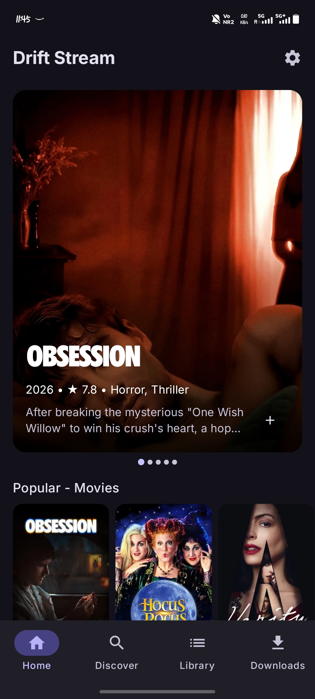
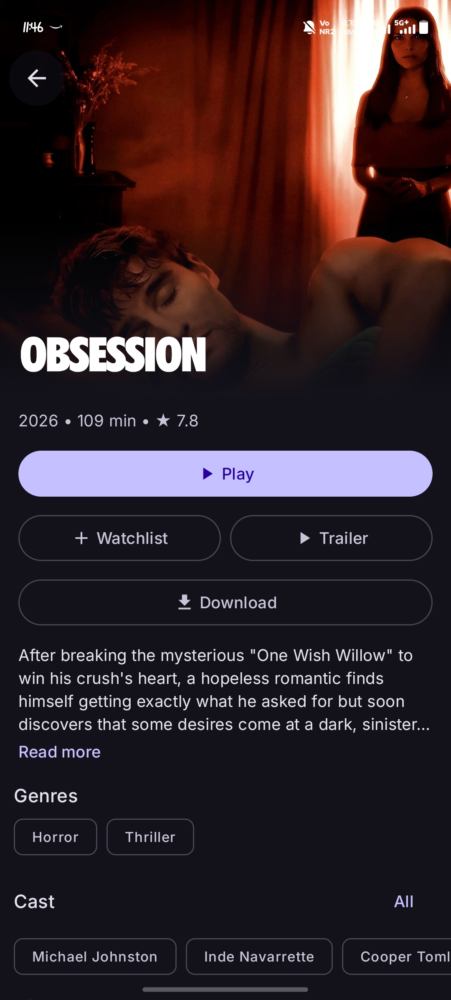
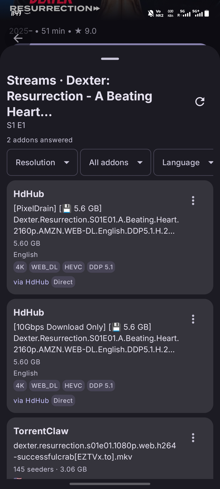
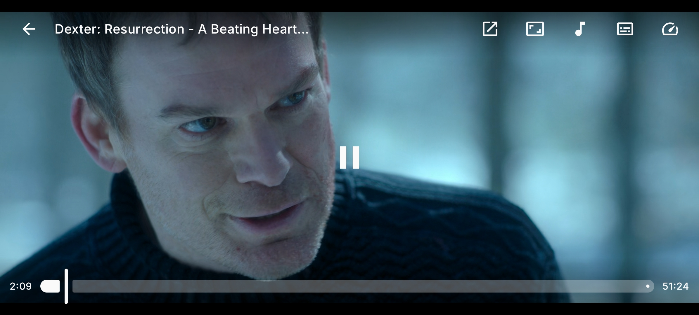

# Drift Stream

A native Android client for Stremio addons with its own interface, a built-in torrent streaming engine and a libVLC player.

  
  
  

  

## What it is

Drift Stream ships no content and no stream addon.
Only Cinemeta (catalogs and metadata) is preinstalled.
You add stream addons yourself.

## Features

- Addons added by URL or `stremio://` link
- Home with hero, catalog rows, Continue Watching and row configuration
- Discover and search
- Title details with seasons, episodes, watched marks and watchlist statuses
- Streams sheet with sorting, filters and Quick play
- Built-in torrent streaming with a cache limit and a Wi-Fi gate
- libVLC player with gestures, audio and subtitle tracks, subtitles from addons, subtitle style and speed
- Resume, next episode and auto-play next
- Library with watchlist and history
- Downloads for direct links and torrents with queue, resume and an optional move to Gallery
- Theming (accent color, dynamic color, AMOLED, fonts, sizes, roundness)
- Family mode (on by default): hides adult addons and content
- No ads, no analytics, no accounts

## Requirements and install

Android 12 or newer, 64-bit ARM (arm64-v8a) phones only.

Download the APK from the repository's Releases page (https://github.com/Pranjalbudaniya/Drift-Stream/releases), allow installing from this source, and install.

Updates: Settings, the updates card (Check for updates).

The debug build installs as `com.drift.stream.debug` beside the release build.

## First run

Add stream addons in Settings (Settings > Manage addons).

## Build from source

JDK 17 or newer; an Android SDK with API 37; network access (jlibtorrent comes from FrostWire's Maven repository at https://dl.frostwire.com/maven).

Debug build: `./gradlew assembleDebug`

Verification: `./gradlew checkAll` (assemble, unit tests, detekt, spotless, hexGuard).

Release build: create `keystore.properties` in the repository root with `storeFile`, `storePassword`, `keyAlias`, and `keyPassword` (never commit it), then run `./gradlew assembleRelease`. Every release must be signed with the same key or installed copies cannot update. The version comes from `appVersionName` in `app/build.gradle.kts`. Keep `app/build/outputs/mapping/release/mapping.txt` of every published release, because crash traces from the minified app cannot be read without it.

Publish: create a GitHub release tagged `v` plus the version, and attach the APK.

## Architecture

Kotlin, Jetpack Compose, Material 3.
Clean Architecture with MVVM in a single module (data, domain, presentation).
Hilt, Room, DataStore.
Retrofit, OkHttp, kotlinx.serialization, Coil.
jlibtorrent and libVLC. Versions are in gradle/libs.versions.toml.

## Disclaimer

Drift Stream is a media player. It does not host, provide or recommend any content. Everything you watch comes from addons you install yourself, and you are responsible for following the laws that apply to you.

Drift Stream is an independent project and is not affiliated with Stremio.

## Third-party software

Open-source licenses are listed in the app (Settings > About > Open-source licenses).
jlibtorrent and MaterialKolor are MIT, libVLC is LGPL-2.1, and the bundled fonts are OFL.
